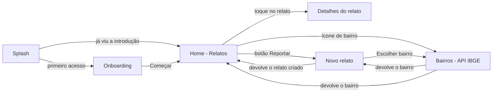
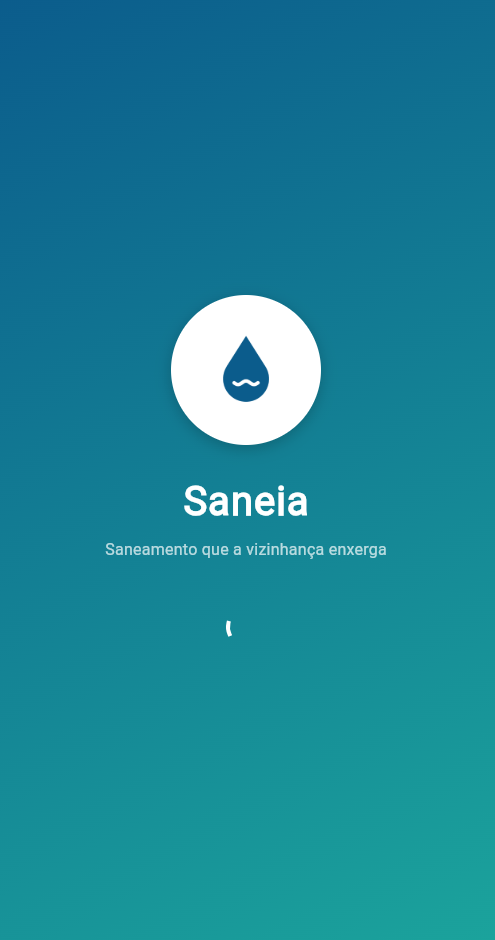
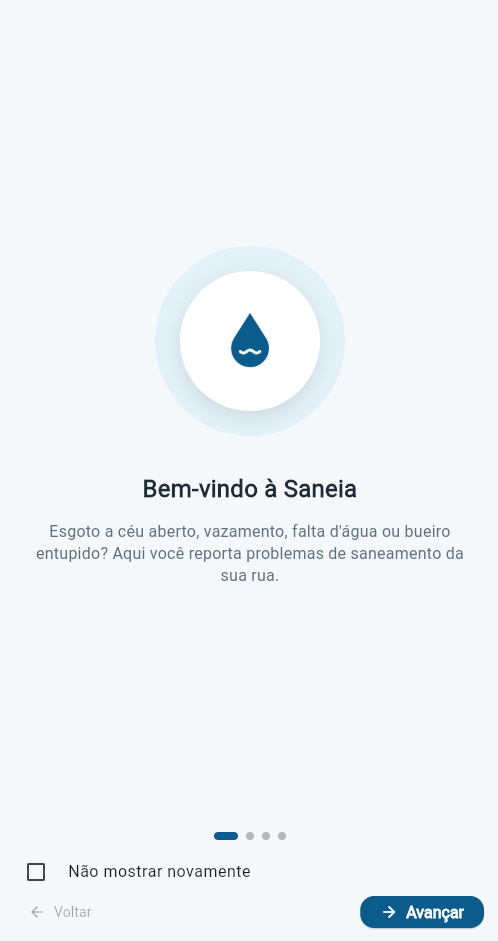
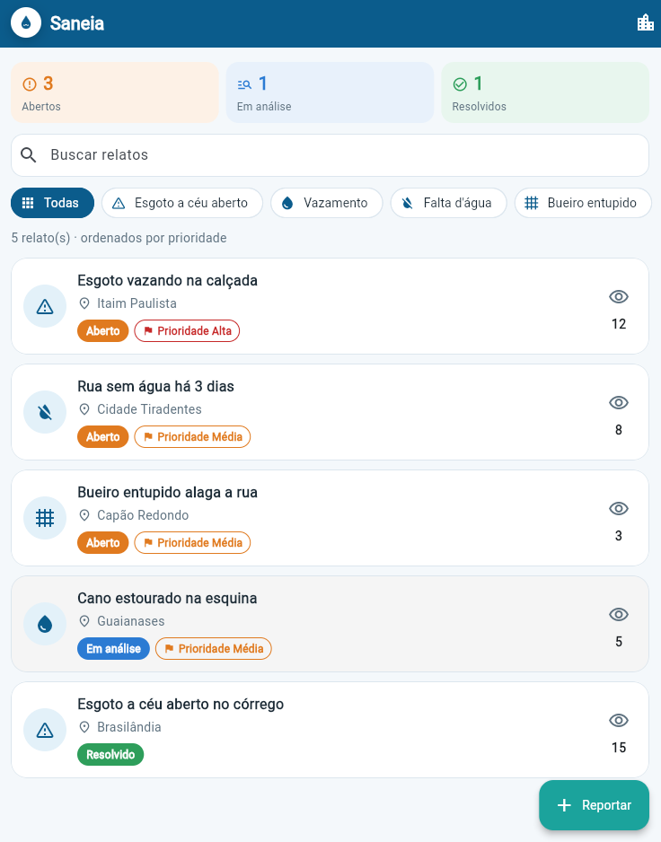
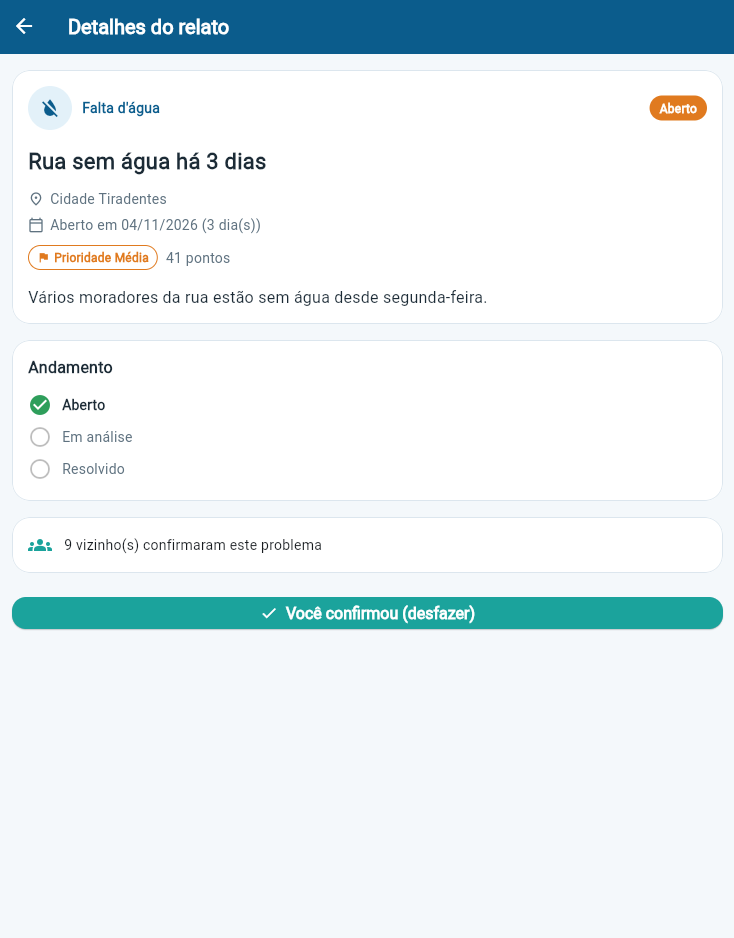
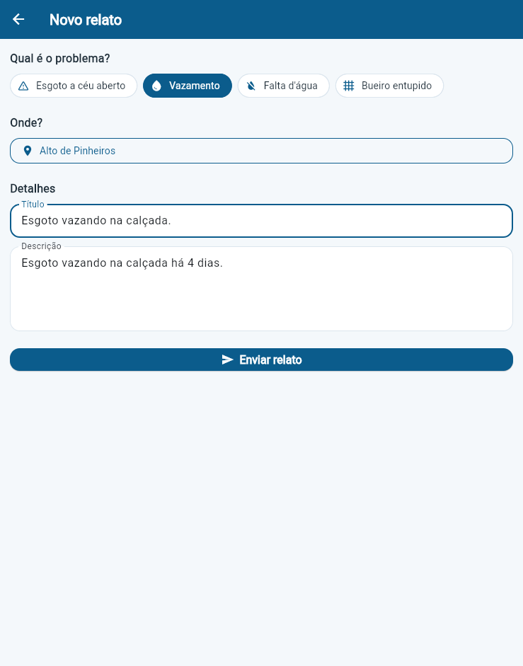
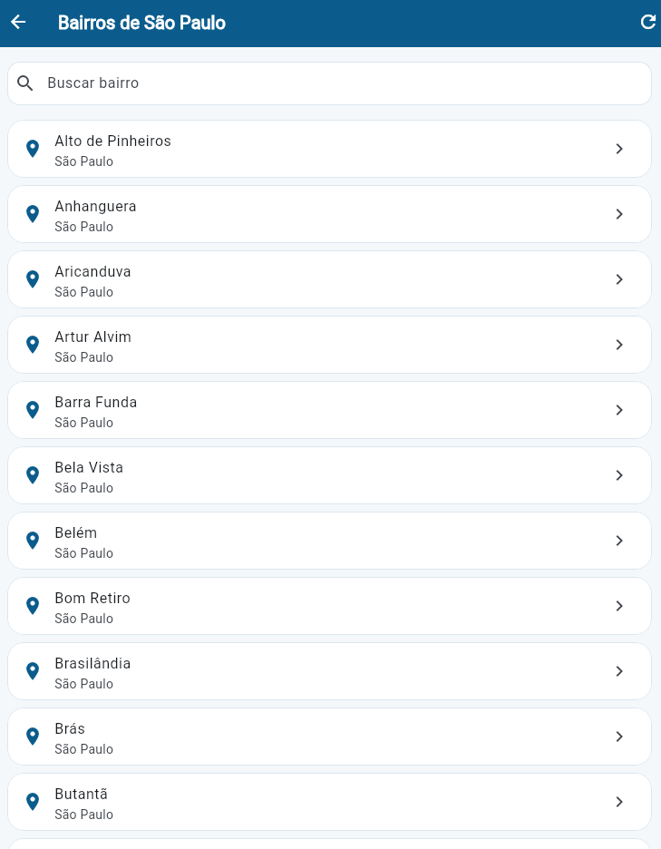
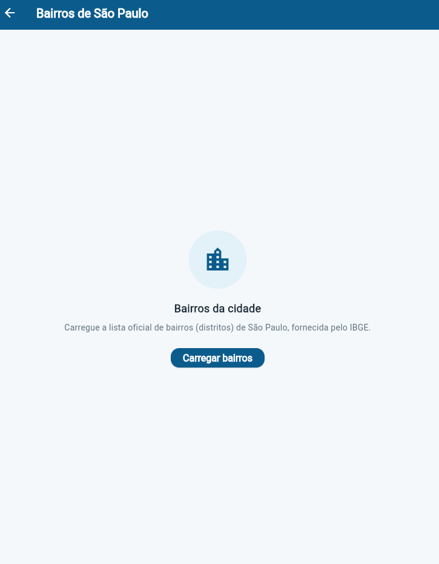
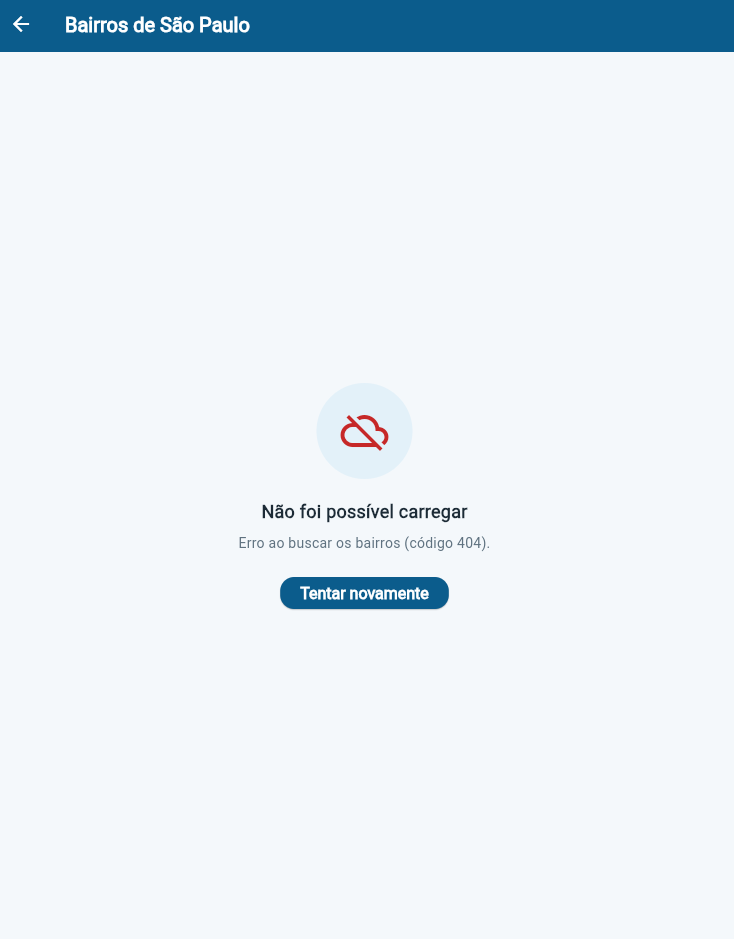

# Saneia

Aplicativo mobile em **Flutter/Dart** para moradores reportarem problemas de saneamento da rua: esgoto a céu aberto, vazamento, falta d'água e bueiro entupido.

## Desenvolvedoras

| Nome completo | RM |
|---|---|
| Rebeca Berbert Barcelos | RM556683 |
| Julia Mendes Pessoa Dutra | RM557645 |

## Vídeo pitch

[Assistir ao pitch no YouTube](https://www.youtube.com/watch?v=h9_t4r6XUkk)

## Tema da Global Solution

**Cidades e saneamento básico.** Sem esgoto e água tratada, as cidades enfrentam mais doenças e enchentes piores, e quem mais sofre é a periferia. Hoje o morador não sabe a quem reclamar e não recebe retorno. Já a concessionária recebe reclamações soltas, sem localização nem prioridade.

ODS relacionados: 6 (água potável e saneamento), 3 (saúde e bem-estar), 10 (redução das desigualdades) e 11 (cidades e comunidades sustentáveis).

## Descrição da solução

A Saneia é o app do morador dentro da nossa solução. Com ele, o morador pode:

- **Reportar** um problema escolhendo a categoria, o bairro, um título e uma descrição.
- **Ver os relatos da cidade**, ordenados por **prioridade**. A prioridade soma a gravidade da categoria, as confirmações da vizinhança e o tempo em aberto. Relatos resolvidos vão para o fim da lista.
- **Acompanhar o resumo** dos relatos (abertos, em análise e resolvidos) logo no topo da tela inicial.
- **Confirmar** um relato de outro morador ("Também vejo isso"), o que aumenta a prioridade dele.
- **Buscar e filtrar** os relatos por texto, categoria e bairro.
- **Acompanhar o status** de cada relato: aberto, em análise ou resolvido.

## Fluxo de telas



1. **Splash:** exibe o logo e, depois de 2 segundos, consulta o `SharedPreferences`. Se o usuário marcou "Não mostrar novamente", vai para a Home. Caso contrário, vai para o Onboarding.
2. **Onboarding:** 4 páginas com imagem ou ícone, título e descrição, botões **Voltar** e **Avançar** e a opção **"Não mostrar novamente"**. Ao finalizar, a opção escolhida é salva no `SharedPreferences`.
3. **Home (Relatos):** resumo por status, busca, filtro por categoria, filtro por bairro, lista de relatos e botão de confirmação em cada card.
4. **Detalhes do relato:** recebe o `Report` por parâmetro e mostra os dados, a prioridade, o andamento do status e o botão "Também vejo isso".
5. **Novo relato:** formulário com validação. Devolve o relato criado para a Home, que exibe uma mensagem de confirmação.
6. **Bairros:** consome a API do IBGE e trata os estados inicial, carregando, sucesso e erro. Tem busca e "puxar para atualizar" e devolve o bairro escolhido para a tela anterior.

### Passagem de parâmetros entre telas

A navegação usa `Navigator.push` com `MaterialPageRoute` e `Navigator.pop`. Os parâmetros são passados pelo construtor da tela de destino.

| De → Para | Parâmetro |
|---|---|
| Home → Detalhes | `Report` (construtor de `ReportDetailScreen`) |
| Home / Novo relato → Bairros | nome do bairro já selecionado (`String?`, construtor de `NeighborhoodsScreen`) |
| Bairros → tela anterior | `Neighborhood` escolhido (`Navigator.pop`) |
| Novo relato → Home | `Report` criado (`Navigator.pop`) |

## Prints das telas

| Splash | Onboarding | Home |
|---|---|---|
|  |  |  |

| Detalhes | Novo relato | Bairros (API) |
|---|---|---|
|  |  |  |

| Bairros - estado inicial | Bairros - erro |
|---|---|
|  |  |

## API utilizada

**API de Localidades do IBGE** (pública, sem autenticação), consumida com o pacote `http`.

- Endpoint: `GET https://servicodados.ibge.gov.br/api/v1/localidades/municipios/3550308/distritos`
- Retorna os 96 distritos (bairros) do município de São Paulo (código IBGE 3550308).
- O JSON é convertido no model `Neighborhood` (`Neighborhood.fromJson`).

Formato de cada item da resposta:

```json
{
  "id": 355030801,
  "nome": "Água Rasa",
  "municipio": { "id": 3550308, "nome": "São Paulo" }
}
```

Os estados tratados na tela de Bairros (`ViewState`) são:

| Estado | O que aparece |
|---|---|
| `initial` | explicação e botão "Carregar bairros" |
| `loading` | indicador de progresso |
| `success` | lista de bairros com busca |
| `error` | mensagem amigável e botão "Tentar novamente" |

## Arquitetura

```
lib/
├── main.dart                 # MaterialApp, tema e tela inicial (Splash)
├── theme/                    # AppColors e AppTheme
├── models/                   # Report, Neighborhood, ReportCategory, ReportStatus, PriorityLevel, ViewState
├── services/                 # IbgeService (http), PreferencesService (SharedPreferences), ApiException
├── repositories/             # ReportRepository: dados e regras de negócio
├── screens/                  # telas (Splash, Onboarding, Home, Detalhes, Novo relato, Bairros)
├── widgets/                  # widgets reutilizáveis
└── utils/                    # formatação de data
```

- **Interface (`screens`, `widgets`):** só exibe dados e repassa as ações do usuário.
- **Models (`models`):** representam os dados. `Neighborhood.fromJson` converte o JSON da API.
- **Serviços (`services`):** acesso externo. O `IbgeService` faz a requisição HTTP e o `PreferencesService` lê e grava no `SharedPreferences`.
- **Repositório (`repositories`):** guarda os relatos em memória e concentra as regras de negócio, como filtro, cálculo de prioridade, confirmação e criação de relatos. Assim, essas regras ficam fora dos widgets.
- **Gerenciamento de estado:** `setState` em `StatefulWidget`. Componentes sem estado próprio usam `StatelessWidget`.
- **Navegação:** `Navigator.push`, `Navigator.pushReplacement` e `Navigator.pop` (com resultado) usando `MaterialPageRoute`.
- **Tema:** cores em `AppColors` e `ThemeData` em `AppTheme` (Material 3), para manter o visual consistente.

### Widgets reutilizáveis

| Widget | Onde é usado |
|---|---|
| `AppCard` | cards da Home, Detalhes e Bairros |
| `LogoBadge` | Splash e AppBar da Home |
| `ReportCard` | itens da lista da Home |
| `StatusChip` | card e tela de detalhes |
| `PriorityChip` | card e tela de detalhes |
| `InfoRow` | card e tela de detalhes |
| `StatsBoard` e `StatCard` | resumo por status na Home |
| `StatusStep` | andamento do relato na tela de detalhes |
| `CategorySelector` | filtro da Home e formulário de Novo relato |
| `StateMessage` | estados inicial e erro de Bairros, lista vazia da Home |
| `SectionTitle` e `FieldErrorText` | formulário de Novo relato |
| `OnboardingItem` | cada página do Onboarding |

### Interações com o usuário

1. Tocar em um relato da lista abre a tela de detalhes.
2. Buscar relatos por texto e filtrar por categoria e por bairro.
3. Confirmar um relato ("Também vejo isso"): o ícone, a cor e o contador mudam e a ordem de prioridade é atualizada.
4. Criar um relato pelo botão de ação "Reportar".
5. Atualizar a lista de bairros (botão de atualizar e "puxar para atualizar").

## Como executar

Pré-requisito: Flutter 3.x instalado.

```bash
flutter pub get
flutter run
```

> O projeto já inclui as pastas de plataforma (`android`, `ios` e `web`), e o `AndroidManifest.xml` já tem a permissão de internet, então não é preciso rodar `flutter create`.

Para rodar os testes:

```bash
flutter test
```
